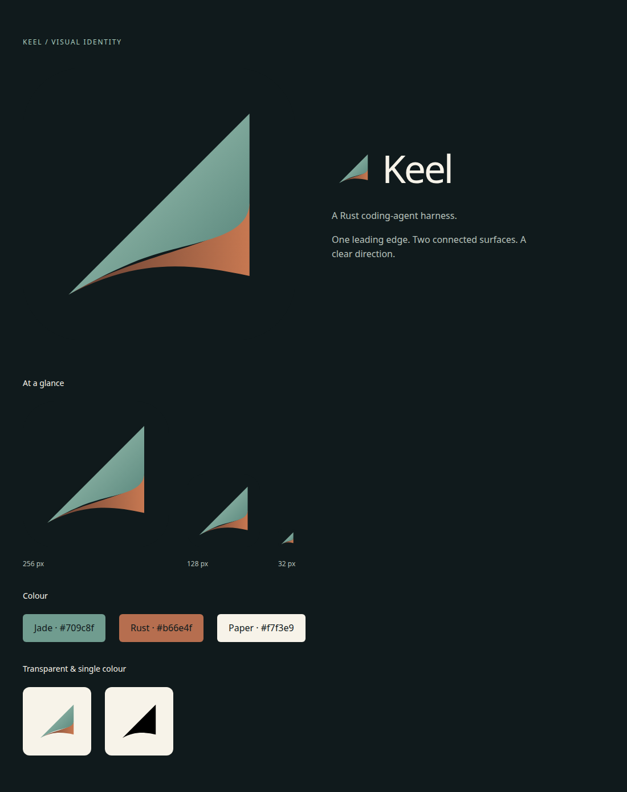

# Keel visual identity & product family

The sail carries the supplied Flow direction into a simple vector mark: a jade
leading surface, a rust underside, and an ink tile. The two surfaces meet along
one continuous curve. No texture, tiny outlines or drop shadows are needed.

## Canonical palette

| Token | Value | Light-mode pair | Use |
| --- | --- | --- | --- |
| Ink | `#0a1112` | — | Primary dark canvas |
| Surface | `#101a1c` | `#ffffff` | Icon tile, cards, panels |
| Surface Raised | `#162426` | `#ece6d9` | Hover states, nested rows |
| Paper | `#f7f3e9` | `#f3eee4` | Light canvas, primary CTAs, dark-surface wordmark |
| Foam | `#eef4f2` | `#2a241c` | Primary body copy |
| Muted | `#8ca3a0` | `#7a7266` | Secondary labels and metadata |
| Jade | `#36b394` | `#1e705c` | Leading sail surface, active brand accent |
| Jade Bright | `#76dfc2` | — | Focus rings, highlights, dark-mode UI accent |
| Jade Deep | `#217a65` | `#1e705c` | Sail gradient shadow, pressed accent |
| Rust | `#dc7648` | `#9e4722` | Sail underside, hardware/section markers |
| Rust Bright | `#f09467` | — | Sail underside highlight |
| Rust Deep | `#8f4224` | `#9e4722` | Sail underside shadow |

- `icon.svg`: rounded app tile (`#101a1c` tile with `#76dfc2 → #217a65` Jade and `#8f4224 → #f09467` Rust); PNG exports at 32, 128, 256, 512 and 1024px.
- `mark.svg`: transparent symbol for headers and app integrations.
- `mark-mono.svg`: flat single-colour symbol; inherits `currentColor` inline.
- `preview.html`: inspect the mark, wordmark, colour and small-size variants.

Keep the symbol proportional. Leave at least one quarter of its width as clear
space. Use the flat mark for single-colour output. The wordmark uses the host's
sans-serif typeface and remains live text, so it needs no bundled font.

These assets do not change the CLI or TUI terminal palette.

To re-export a PNG, render `icon.svg` at its exact target size on a transparent
canvas in a browser. The supplied PNGs were rendered headlessly in Chromium.

## Product family

Positioning is canonical in [VISION.md](../VISION.md): the Keel CLI is the
coding agent (the Claude Code role); Keel Desktop is the everyday app (the
Claude Desktop role) whose Code mode is the Keel CLI.

| Product | Surface | Role |
| --- | --- | --- |
| **Keel** | CLI & TUI (`keel`) | Core Rust coding-agent harness for small local models |
| **Keel Desktop** | macOS, Linux, Windows (`keel-desktop`) | GUI workspace (Chat, Work, Code, Apps, MCP) |
| **Keel Mobile** | iOS (`keel-mobile`) | Standalone on-device iPhone agent on Metal |
| **Keel Console** | Xbox Series S\|X / 10-ft TV (`keel-xbox`) | Living-room console app (WASM, LAN, UWP) |
| **Keel Arena** | Python CLI (`keel-arena`) | Edge AI & agent benchmarking suite and SVG scorecards |
